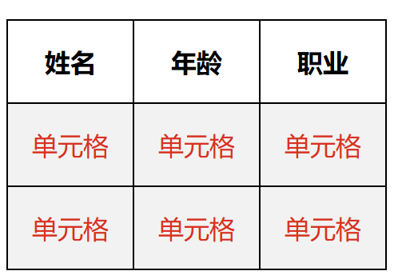

# CSS学习笔记
## 一、CSS概念
CSS层叠样式表，又叫级联样式表，简称样式表；CSS文件后缀名为.css,简称样式表，用于HTML中元素样式的定义，从而让网页具有美观一致的页面。
## 二、CSS语法
### 1.CSS规则
CSS主要有两个主要部分构成：选择器和样式

- 选择器通常是需要改变的HTML元素
- 每条声明有一个属性和一个值构成,声明之间用分号隔开
- 属性是我们希望设置的样式属性。每个属性有一个值，属性和值被冒号分开。例如：
h1{color:blue;font-size:12p;}
### 2.CSS的引入方式
  (1)内联样式（行内样式）：
  - 直接在相关的标签内部使用样式（style）属性。Style属性可以包含任意CSS属性。例如：
```
<p style="color:red;font-size=100px;">内容</p>
```
- 缺点：缺乏整体性和规划性，如果有相同的标签使用同样的样式，需要逐个复制。
  
(2)内部样式：
- 当单个文档需要特殊的样式时，就应该使用内部样式表。可以使用```<style>```标签在文档头部定义样式。例如：
```
<style>
h1{
    color:blue;
    font-size:12p;
}
</style>
```
- 缺点：只在单个页面中具有统一性和规划性，但是若有多个页面则容易混乱
  
（3）外部样式（推荐）

- 当样式需要应用于很多页面时，外部样式表将是理想的选择。在使用外部样式表的情况下，可以通过改变一个文件来改变整个站点的外观。每个页面使用<link>标签链接到样式表。<link>标签写在头部。例如：
```
<link rel="stylesheet" href="CSS文件.css">
```

### 3.CSS的选择器
(1)全局选择器：可以与任何元素匹配，优先级最低，一般做样式初始化。例如：
```
*{font-size:300px;
  color:red;
  }
```
(2)元素选择器：用于HTML文档中的元素，p b div a img body
- 选择的是页面上所有这种类型的标签，所以经常描述共性，无法描述某一个元素的个性。例如：
```
p{
    font-size:10px;
 }
```
让所有p标签都带上这个特性
- 如果想让一句话中的一部分具有某种特性，则可以使用<span>标签把要改变的部分围起来，然后给span加一个标签选择器。例如：
```
<p>我先学数学再学<span>英语</span>
span{
    color:red;
     }
```
- 所有的标签都可以是选择器，比如ul\li\lable\div等
- 无论这个标签被嵌套的有多深，都一定能被选择上
- 选择的是所有同类型标签，而不是只有一个
  
（3）类选择器：规定用圆点.来定义，针对想要的标签使用。例如：
```
<p>我很开心</p>
<p>我很高兴</p>
<p>我很难过</p>
```
这里我们想让“我很难过”这个语句变红色，则可以这样写：
```
<p class="content">我很难过</p>
```
然后在头部这样写,就可以了：
```
.content{
    color:red;
        }
```
- 类选择器可以被多种标签使用
- 类名不能以数字开头
- 同一个标签可以使用多个类选择器，用空格隔开。例如
 ```
 <h3 class="content size">我是标题</h3>
 ```
 然后在头部这样写,就可以了：
 ```
 .content{
    color:red;
 }
 .size{
    font-size:100px;
 }
 ```
 
 
 （4）ID选择器：针对某一个特定的标签来使用，只能使用一次。用#来定义。例如：
 ```
 <h2 id="mytitle">你好</h2>
 ```
 然后在头部里面这样写，就可以了：
 ```
 #mytitle{
    border:3px solid red;
            }
 ```
- ID是唯一的
- ID不能以数字开头
  
（5）合并选择器：如果想让多个不同的标签应用同样的样式，则可以采用合并选择器，可以提取共同的样式，减少重复代码。例如：
```
<h3>你好</h3>
<p>你好</p>
```
在头部这样写：
```
p,h3{
    color:red;
    font-size:30px;
    }
```
(6)选择器的优先级：
- 元素选择器的权重为1
- class选择器的权重为10
- id选择器的权重为100
- 内联样式的权重为1000
- 当同时作用多个选择器时，优先级高的会生效
### 4.字体属性
(1)color：规定文本的颜色
- 字母：div{color:red}
- 十六进制：div{color:#ff0000}
- rgb三原色：div{color:rgb(255,0,0)}
- rgba三原色加透明度：div{color:rgba(255,0,0,0.5)}
  
(2)font-size:规定文本的大小。例如：
```
h1{font-size:40px;}
h3{font-size:30px;}
p{font-size:14px;}
```
- chrome浏览器接受的最小字体是12px
 
(3)font-weight:设置文本的粗细
- bold：定义粗体字符
- bolder：定义更粗的字符
- lighter：定义更细的字符
- 100-900：定义由粗到细，400等同于默认，700等同于bold
 
(4)font-style:指定文本的字体样式
- normal：默认值
- italic：定义斜体字

 (5)font-family:用于指定元素的字体样式。例如：
 ```
 font-family:"Microsoft YaHei","Simsun",SimHei"
 ```
### 5.背景属性
(1)background-color属性：用于设置背景颜色。例如：
```
<div></div>
```
```
div{
    width:400px;
    height:800px;
    background-color:red;
    }
```
(2)background-image属性：设置元素的背景图像
```
<div class="box"></div>
```
```
.box{
    width：400px；
    height：400px；
    background-image：url("图片地址")
}
```
(3)background-repeat:用于设置如何平铺背景图像，背景元素会根据背景尺寸进行水平或者竖直的重复平铺
- repeat：默认值
- repeat-x：只向水平方向平铺
- repeat-y：只向竖直方向平铺
- no-repeat：不平铺
### 6.文本属性
(1)text-align属性：指定文本的对齐方式。例如：

- left：文本居左排列，默认值
- right：文本居右排列
- center：把文本排列到中间
```
h1{text-align：center}
h2{text-align：left}
h3{text-align：right}
```
(2)text-decoration属性：规定添加到文本的修饰，下划线、上划线、删除线等
- underline：定义下划线
- overline：定义上划线
- line-through：删除线
```
h1{text-decoration：underline}
h2{text-decoration：overline}
h3{text-decoration：line-through}
```
(3)text-transform属性：控制文本的大小写
- capitalize：定义每个单词开头大写
- uppercase：定义全部大写
- lowercase：定义全部小写

```
h1{text-transform：capitalize}
h2{text-transform：uppercase}
h3{text-transform：lowercase}
```
(4)text-indent属性：用于规定文本块中首行文本的缩进。例如：
```
p{
    text-indent:50px;
    } 
```
### 7.表格属性
(1)表格边框：用于指定表格边框，使用border属性。例如：
- 只使用table，只有外围边框，所以要加上td应用到整个单元格里
- 这里加上的边框是双边框。
  
(2) 折叠边框：border-collapse属性设置表格的边框是否被折叠成一个单一的边框或隔开。
- 得先有border（table，td）才能设置这个
  
(3)表格宽度和高度：width和height定义表格的宽度和高度。

(4)表格文字对齐：表格中的文本对齐和垂直对齐属性
- text-align属性设置水平对齐方式，right、left或center
- vertical-align属性设置垂直对齐，top、center和bottom
  
(5)表格填充：用于控制文字和边框之间的距离

(6)表格颜色：用于指定边框、文本、背景的颜色，与文本属性的background-color、color类似

(7)效果练习
