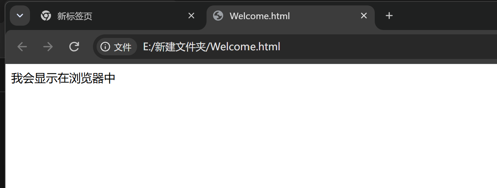
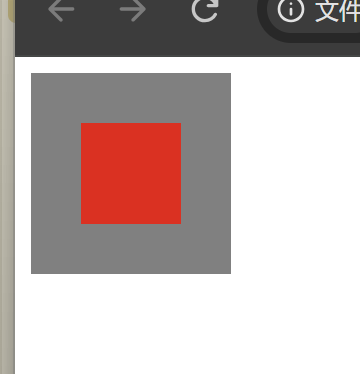
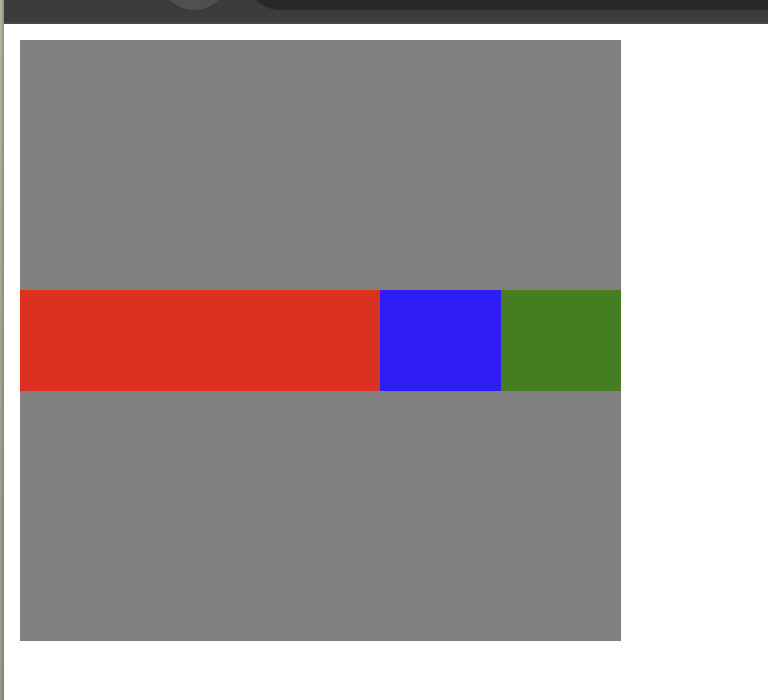
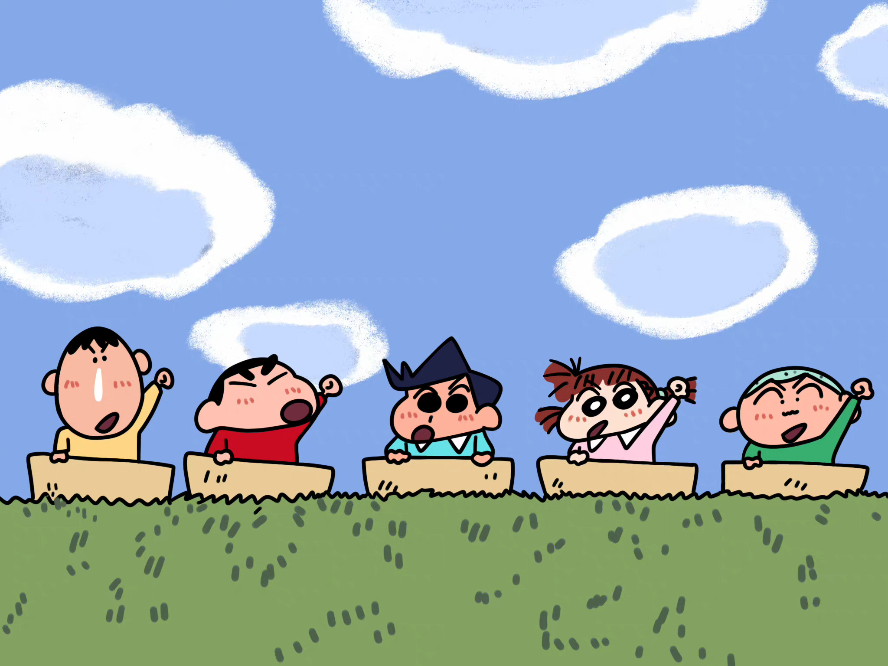
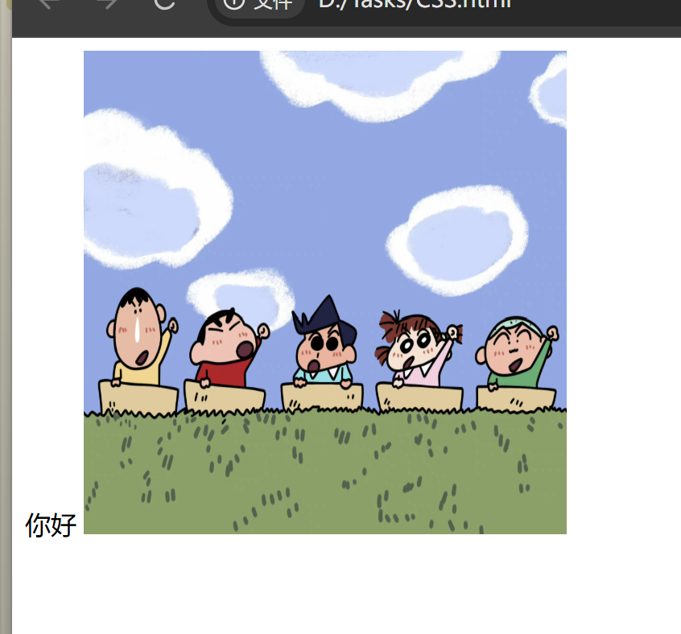
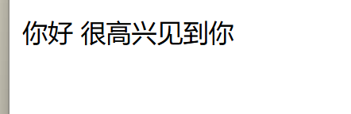
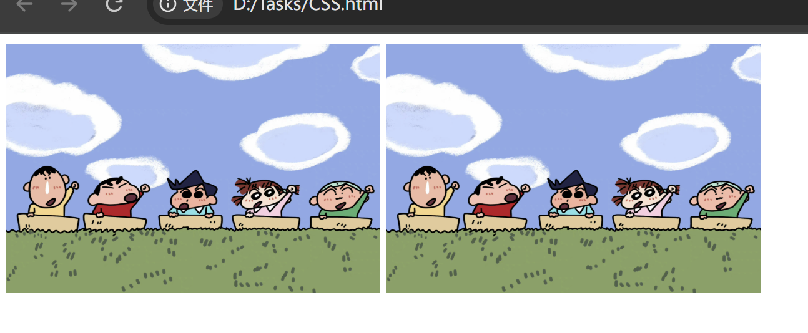
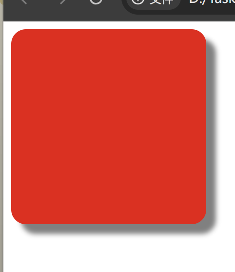

# CSS学习笔记
## 一、CSS概念
CSS层叠样式表，又叫级联样式表，简称样式表；CSS文件后缀名为.css,简称样式表，用于HTML中元素样式的定义，从而让网页具有美观一致的页面。
## 二、CSS语法
### 1.CSS规则
CSS主要有两个主要部分构成：选择器和样式

- 选择器通常是需要改变的HTML元素
- 每条声明有一个属性和一个值构成,声明之间用分号隔开
- 属性是我们希望设置的样式属性。每个属性有一个值，属性和值被冒号分开。例如：
h1{color:blue;font-size:12p;}
### 2.CSS的引入方式
  (1)内联样式（行内样式）：
  - 直接在相关的标签内部使用样式（style）属性。Style属性可以包含任意CSS属性。例如：
```
<p style="color:red;font-size=100px;">内容</p>
```
- 缺点：缺乏整体性和规划性，如果有相同的标签使用同样的样式，需要逐个复制。
  
(2)内部样式：
- 当单个文档需要特殊的样式时，就应该使用内部样式表。可以使用```<style>```标签在文档头部定义样式。例如：
```
<style>
h1{
    color:blue;
    font-size:12p;
}
</style>
```
- 缺点：只在单个页面中具有统一性和规划性，但是若有多个页面则容易混乱
  
（3）外部样式（推荐）

- 当样式需要应用于很多页面时，外部样式表将是理想的选择。在使用外部样式表的情况下，可以通过改变一个文件来改变整个站点的外观。每个页面使用<link>标签链接到样式表。<link>标签写在头部。例如：
```
<link rel="stylesheet" href="CSS文件.css">
```

### 3.CSS的选择器
(1)全局选择器：可以与任何元素匹配，优先级最低，一般做样式初始化。例如：
```
*{font-size:300px;
  color:red;
  }
```
(2)元素选择器：用于HTML文档中的元素，p b div a img body
- 选择的是页面上所有这种类型的标签，所以经常描述共性，无法描述某一个元素的个性。例如：
```
p{
    font-size:10px;
 }
```
让所有p标签都带上这个特性
- 如果想让一句话中的一部分具有某种特性，则可以使用<span>标签把要改变的部分围起来，然后给span加一个标签选择器。例如：
```
<p>我先学数学再学<span>英语</span>
span{
    color:red;
     }
```
- 所有的标签都可以是选择器，比如ul\li\lable\div等
- 无论这个标签被嵌套的有多深，都一定能被选择上
- 选择的是所有同类型标签，而不是只有一个
  
（3）类选择器：规定用圆点.来定义，针对想要的标签使用。例如：
```
<p>我很开心</p>
<p>我很高兴</p>
<p>我很难过</p>
```
这里我们想让“我很难过”这个语句变红色，则可以这样写：
```
<p class="content">我很难过</p>
```
然后在头部这样写,就可以了：
```
.content{
    color:red;
        }
```
- 类选择器可以被多种标签使用
- 类名不能以数字开头
- 同一个标签可以使用多个类选择器，用空格隔开。例如
 ```
 <h3 class="content size">我是标题</h3>
 ```
 然后在头部这样写,就可以了：
 ```
 .content{
    color:red;
 }
 .size{
    font-size:100px;
 }
 ```
 
 
 （4）ID选择器：针对某一个特定的标签来使用，只能使用一次。用#来定义。例如：
 ```
 <h2 id="mytitle">你好</h2>
 ```
 然后在头部里面这样写，就可以了：
 ```
 #mytitle{
    border:3px solid red;
            }
 ```
- ID是唯一的
- ID不能以数字开头
  
（5）合并选择器：如果想让多个不同的标签应用同样的样式，则可以采用合并选择器，可以提取共同的样式，减少重复代码。例如：
```
<h3>你好</h3>
<p>你好</p>
```
在头部这样写：
```
p,h3{
    color:red;
    font-size:30px;
    }
```
(6)选择器的优先级：
- 元素选择器的权重为1
- class选择器的权重为10
- id选择器的权重为100
- 内联样式的权重为1000
- 当同时作用多个选择器时，优先级高的会生效
### 4.字体属性
(1)color：规定文本的颜色
- 字母：div{color:red}
- 十六进制：div{color:#ff0000}
- rgb三原色：div{color:rgb(255,0,0)}
- rgba三原色加透明度：div{color:rgba(255,0,0,0.5)}
  
(2)font-size:规定文本的大小。例如：
```
h1{font-size:40px;}
h3{font-size:30px;}
p{font-size:14px;}
```
- chrome浏览器接受的最小字体是12px
 
(3)font-weight:设置文本的粗细
- bold：定义粗体字符
- bolder：定义更粗的字符
- lighter：定义更细的字符
- 100-900：定义由粗到细，400等同于默认，700等同于bold
 
(4)font-style:指定文本的字体样式
- normal：默认值
- italic：定义斜体字

 (5)font-family:用于指定元素的字体样式。例如：
 ```
 font-family:"Microsoft YaHei","Simsun",SimHei"
 ```
### 5.背景属性
(1)background-color属性：用于设置背景颜色。例如：
```
<div></div>
```
```
div{
    width:400px;
    height:800px;
    background-color:red;
    }
```
(2)background-image属性：设置元素的背景图像
```
<div class="box"></div>
```
```
.box{
    width：400px；
    height：400px；
    background-image：url("图片地址")
}
```
(3)background-repeat:用于设置如何平铺背景图像，背景元素会根据背景尺寸进行水平或者竖直的重复平铺
- repeat：默认值
- repeat-x：只向水平方向平铺
- repeat-y：只向竖直方向平铺
- no-repeat：不平铺
### 6.文本属性
(1)text-align属性：指定文本的对齐方式。例如：

- left：文本居左排列，默认值
- right：文本居右排列
- center：把文本排列到中间
```
h1{text-align：center}
h2{text-align：left}
h3{text-align：right}
```
(2)text-decoration属性：规定添加到文本的修饰，下划线、上划线、删除线等
- underline：定义下划线
- overline：定义上划线
- line-through：删除线
```
h1{text-decoration：underline}
h2{text-decoration：overline}
h3{text-decoration：line-through}
```
(3)text-transform属性：控制文本的大小写
- capitalize：定义每个单词开头大写
- uppercase：定义全部大写
- lowercase：定义全部小写

```
h1{text-transform：capitalize}
h2{text-transform：uppercase}
h3{text-transform：lowercase}
```
(4)text-indent属性：用于规定文本块中首行文本的缩进。例如：
```
p{
    text-indent:50px;
    } 
```
### 7.表格属性
(1)表格边框：用于指定表格边框，使用border属性。例如：
- 只使用table，只有外围边框，所以要加上td应用到整个单元格里
- 这里加上的边框是双边框。
  
(2) 折叠边框：border-collapse属性设置表格的边框是否被折叠成一个单一的边框或隔开。
- 得先有border（table，td）才能设置这个
  
(3)表格宽度和高度：width和height定义表格的宽度和高度。

(4)表格文字对齐：表格中的文本对齐和垂直对齐属性
- text-align属性设置水平对齐方式，right、left或center
- vertical-align属性设置垂直对齐，top、center和bottom
  
(5)表格填充：用于控制文字和边框之间的距离

(6)表格颜色：用于指定边框、文本、背景的颜色，与文本属性的background-color、color类似

(7)效果练习
### 8.关系选择器
(1)后代选择器：用于定义所有被E元素包含的F元素，中间用空格隔开：E F{}。例如：
```
<ul>
<li>苹果</li>
<li>橘子</li>
<li>香蕉</li>
</ul>
```
```
ul li{
    color:green;
}
```
就能实现ul下面的li标签都变成绿色

(2)子代选择器：选择所有作为E元素的直接子元素F,对更深一层的元素不起作用，用>表示:E>F.例如：
```
<div>
    <p>大家好</p>
    <ul>
        <li>
            <p>很高兴见到你</p>
        </li>
    </ul>
<div>
```
```
div>p{
    color:red;
}
```
只有直接的p标签大家好变红，更深一层的很高兴见到你不变色

(3)相邻兄弟选择器：选择紧跟E元素后面的F元素，用加号表示，选择下一个相邻的第一个兄弟元素：E+F{}。例如：
```
<h1>标题</h1>
<p>内容一</p>
<p>内容二</p>
```
```
h1+p{
    color:red;
}
```
只有第一个p标签里面的内容一变红，下一个不变红。

(4)通用兄弟选择器：选择E元素后面的所有兄弟元素F，作用于多个元素，用 ~ 隔开：E ~F。例如：
```
<h1>标题</h1>
<p>内容一</p>
<p>内容二</p>
```
```
h1~p{
    color:red;
}
```
这样p标签后面所有的h1标签都变红。
### 9.盒子模型
(1) content（内容）：盒子的内容，显示文本和图像
  
(2) Padding（内边距）：清楚内容周围的区域（两个值，第一个值代表上下，第二个值代表左右）
  
- padding-left/right/top/bottom:可以分别设置上下左右的边距 
(3) Border（边框）：围绕在内边距和内容外的边框
(4) Margin（外边距）：清除边框外的区域，外边距是透明的（两个值，第一个值代表上下，第二个值代表左右）

- margin-left/right/top/bottom:可以分别设置上下左右的边距 
```
<div>我是内容</div>
```
```
div{
    padding:50px 10px;
    border:5px solid red;
    margin:50px 50px;
    }
```
(5)如果把盒子模型看作快递，那么内容部分就是买的物品，内边距为物品外面的泡沫，边框等同于快递盒子，外边距等同于两个快递盒子之间的距离。
### 10.弹性盒子模型
(1)定义：弹性盒子模型是一种当页面需要适应不同的屏幕大小以及设备类型时，确保元素拥有恰当的行为的布局方式。引入弹性和的目的是提供一种更加有效的方式来对一个容器中的子元素进行排列、对齐和分配空白空间。 

(2)弹性盒子内容：弹性盒子由弹性容器和弹性子元素组成；弹性容器通过设置display属性的值为flex将其定义为弹性容器，弹性容器内包含了一个或多个子元素。(默认弹性盒子里元素横向摆放)

(3)父元素上的属性：

- display属性：```display：flex；```开启弹性盒
- flex-direction属性：用于指定弹性子元素在父容器中的位置

    - flex-direction：row；横向从左到右排列
    - flex-direction：row-reverse；反转横向排列（右对齐，从后往前排，最后一项排在最前面）
    - flex-direction：column；纵向排列、
    - flex-direction：column-reverse；反转纵向排列（从后往前排，最后一项排在最上面）
- justify-content属性：让子元素在垂直方向上对齐摆放（上中下）
  
    - jusitfy-content：flex-start；让子元素居上填充
    - jusitfy-content：flex-end；让子元素居下填充
    - jusitfy-content：center；让子元素居中填充
- align-items属性：让子元素在水平方向上对齐摆放（左中右）
    - align-items：flex-start；让子元素居左填充
    - align-items：flex-end；让子元素居右填充
    - align-items：center；让子元素居中填充
    - 
  这里演示一个让子元素完全居中的例子:
(4)子元素上的属性：用于设置子元素在容器中的占比空间（权重）
- flex：数字；例如：
```
  <div class="content">
        <div class="box1"></div>
        <div class="box2"></div>
        <div class="box3"></div>
    </div>
```
```
 .content{
        width: 300px;
        height: 300px;
        background-color: grey;
        display: flex;
        justify-content:center;
        align-items:center;
    }
    .box1{
        width: 50px;
        height: 50px;
        background-color: red;
        flex:3;
    }
    .box2{
        width: 50px;
        height: 50px;
        background-color: blue;
        flex:1;
    }
    .box3{
        width: 50px;
        height: 50px;
        background-color: green;
        flex:1;
```
效果如下：
### 11.文档流
(1)文档流是文档中可显示对象在排列时所占用的位置或空间，例如，块元素从上到下摆放，内联元素从左到右摆放。
(2)文档流里面的限制非常多，导致很多页面效果无法实现
- 高矮不齐，底边对齐。例如：
```
<span>你好</span>

```

- 空白折叠：无论多少个空格、换行、tab都会只显示一个空格的效果
```
 <p>你好     很高兴见到你</p>
```



 - 两个img图像之间会有空隙，如果想让它们没有空隙，则两个img必须前后紧密连接，但是这样不符合习惯.例如：
  ```


```
 - 
(3)脱离文档流的方式：浮动、绝对定位、固定定位

### 12.定位
(1)position属性指定了元素的定位类型
- relative：相对定位，通过改变元素距离上下左右的距离可以改变元素在页面中的任意位置
- absolute：绝对定位，脱离文档流，不会参与正常的排版；定位元素会覆盖在标准元素的上面，且后设置的定位元素会覆盖在前一个定位元素上
- fixed:固定定位：脱离文档流，元素在页面中的位置不会改变
(2)设置定位之后，相对定位和绝对定位是相对于具有定位的父级元素进行位置调整，如果父级元素不存在，则继续向上逐级寻找，直到顶层文档。比如说，如果父级元素有定位，则子级元素的一些性质是以它的父级元素为参考的，比如给这个子级元素设置left：25 top：25，则它是距离父级元素的左边25，上边25，而不是距离文档左边25，上边25。
```
<div class="container">
        <div class="box1"></div>

</div>
```
```
.container{
        width: 200px;
        height: 200px;
        background-color: red;
        position: relative;
        margin: 100px;


    }
    .box1{
        width: 100px;
        height: 100px;
        background-color: blue;
        position: absolute;
        left: 25px;
        top: 25px;
    }
```
### 13.圆角和阴影
(1)圆角：border-radius

-  四个值：第一个值为左上角，第二个值为右上角，第三个值为右下角，第四个值为左下角

-  三个值：第一个值为左上角，第二个值为右上角和左下角，第三个值为右下角

- 两个值：第一个值为左上角与右下角，第二个值为右上角与左下角

- 一个值：四个圆角值相同
  
(2)阴影：box-shadow

- h‑shadow：必须写，阴影水平位置

- v‑shadow：必须写，阴影垂直位置

- blur：可选，模糊程度

- color：可选，阴影颜色
```
.container{
        width: 200px;
        height: 200px;
        background-color: red;
        border-radius:15px;
        box-shadow: 10px 10px 5px grey;
         }
```
    

### 14.动画
(1)动画是使元素从一种样式逐渐变化为另一种样式的效果,可以改变任意多的样式任意多的次数
- 用百分比来规定变化发生的时间，或用关键词 "from" 和 "to"，等同于 0% 和 100%。0% 是动画的开始，100% 是动画的完成。
(2)使用@keyframes创建动画
```
@keyframes name {
  from | 0%{
      css 样式
  }
  percent{
      css 样式
  }
  to | 100%{
      css 样式
  }
}
```
(3)name：动画名称，开发人员自己命名；
percent：为百分比值，可以添加多个百分比值；

(4)animation执行动画：animation：name duration timing-function delay iteration-count direction
- name：设置动画的名称
- duration：设置动画的持续时间
- timing-function：设置动画效果的速率
  - ease：逐渐变慢（默认）
  - linear：匀速
  - ease-in：加速
  - ease-out：减速
  - ease-in-out：先加速后减速

- delay：设置动画的开始时间（延时执行）
- iteration-count：设置动画循环的次数，infinite 为无限次数的循环
- direction：设置动画播放的方向
  -  normal：默认向前播放
  -  alternate：偶数次向前播放，奇数次反向播放
- animation-play-state：控制动画的播放状态，running 代表播放，paused 代表停止播放
  
(5)例子一：变色方块
```
.container{
        width: 100px;
        height: 100px;
        background-color: red;
        animation-name: mymove;
        animation-duration: 3s;
        animation-timing-function: linear;
        animation-iteration-count: infinite;
    }
    div:hover{
        animation-play-state: paused;
    }
    @keyframes mymove{
        0%{
            background-color:red
        }
        25%{
            background-color:blue
        }
        50%{
            background-color:green
        }
        75%{
            background-color:yellow
        }
        100%{
            background-color:red
        }
    }
```
例子二：呼吸圆
```
.container{
        width: 500px;
        height: 500px;
        background-color: #2b92d4;
        margin: 40px auto;
        animation-name: breathe;
        animation-duration: 3s;
        animation-timing-function: ease-in-out;
        animation-iteration-count: infinite;
        animation-direction: alternate;
        box-shadow: 0 1px 2px rgba(0,0,0,0.3);
        border-radius: 50%;
    }
    div:hover{
        animation-play-state: paused;
    }
    @keyframes breathe{
        0%{
            opacity:0.2;
            box-shadow: 0 1px 2px rgba(255,255,255,0.1);
        }
        50%{
            opacity:0.5;
            box-shadow: 0 1px 2px rgba(18,190,84,0.76);
        }
        100%{
            opacity:1;
            box-shadow: 0 1px 2px rgba(59,255,255,1);
        }
       
    }
```


 


