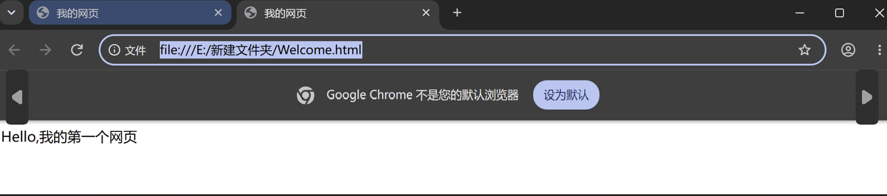
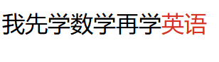
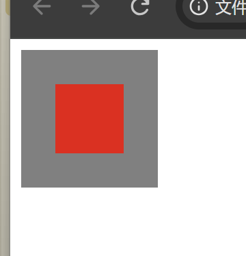
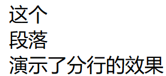

# HTML学习笔记
## 一、初步引入：完成第一个网页程序

- 第一步：使用记事本，编写代码

    - 自选一个盘符，创建一个文本文档（.txt）结尾，把它命名为Welcome.html,然后发现文件前面变成了浏览器图标（本地默认的浏览器）。
    - 右键选中文件选择打开方式为记事本，复制这段代码，然后保存
```
 <html>
                 <head>
                         	<title>我的网页</title>
		 </head>
		 <body>
                   		Hello,我的第一个网页
		 </body>
 </html>
 ```
- 第二步：以浏览器方式打开,就可以看到这个网页了

## 二、正式学习
1.前端工具的选择与安装

- 浏览器：选择Google浏览器
    - 简洁大方，打开速度快
    - 具有良好的调试工具（右侧方框）
    
（只知道有就行，具体内容后续学习）
- 开发者工具：选择VS Code
    - 打开速度快
    - 使用方便

2.VS Code的一些快捷键
- 英文感叹号加回车，自动生成一串代码
,在body里面输入自己的网页内容，再在文件夹里面以浏览器方式打开就可以了；
- 代码格式化：shift+alt+f，让代码变得整齐
- 向上或向下移动一行：alt+up/down
- 快速复制一行代码：shift+alt+up/down
- 快速从浏览器中打开：左侧扩展中搜索open in browser点击安装，打开时就不用再从文件夹里面去找了，直接右键找到这个选项就能从浏览器中打开。

3.HTML5简介与基础骨架
- 前端的用途：做网页、做小程序、做APP、做数据可视化（大屏上展示的饼状图或者柱状图数据，比如体测时看到的的实时大屏）做后台
- HTML简介：
    - HTML是一种超文本标记语言，标记语言是一套标记标签。标签是由尖括号包围的关键字，例如<html>。通过各类标签组织文字、图片、链接等网页内容。
    - HTML5是HTML的第五代标准版本，在旧版HTML上增加了新功能，支持音视频播放、画布绘图、本地存储等，是现在主流的网页结构语言。用HTML5编写的文件，后缀以.html结尾。
    - 简单区分：HTML5是HTML的第五代标准版本，功能更多，是现行最新的标准规范；那有没有所谓的“HTML6 7 8"?答案是没有，新的功能现在都在HTML5的基础上慢慢增加不断优化，不再有新的叫法了。
- HTML的DOCTYPE声明

    - DOCTYPE是document type（文档类型）的缩写。```<!DOCTYPE html>```是HTML5的声明，位于文档的最前面，是网页的必备组成部分，保证浏览器的标准模式，避免浏览器的怪异模式；
    - 什么是浏览器的怪异模式？简单来说就是一些浏览器按照各自的渲染规则形成，页面并不稳定可控。比如文字没有排版，只是挤在一起;
    - 所有的网页都必须有它，例如：

- HTML的基本骨架：
   - **html标签**：定义HTML文档，在浏览器中看到它就能明白这是一个HTML文档，所有其他内容要包裹在它里面，它限定了文件的开始点和结束点
   ```
   <DOCTYPE html>
   <html>
   </html>
   ```
   - **head标签**：定义文档的头部。文档的头部描述了文档的各种属性和信息，包括文档的标题、在web中的位置和其他文档的关系等。大多数头部包含的信息不会真正作为内容显示给读者。
   ```
   <DOCTYPE html>
   <html>
        <head>
        </head>
   </html>
   ```
   - **body标签**：用于定义文档的主体内容。它的内容会直接在页面中显示出来。
   ```
   <DOCTYPE html>
   <html>
        <head>
        </head>
        <body>
            我会显示在浏览器中
        </body>
   </html>
   ```

    - **title标签**：用于定义文档的标题，显示在浏览器窗口的标题栏或状态栏上；```<title>```标签是```<head>```标签中唯一必须要求包含的东西，就是说写head一定要写title。
    ```
   <DOCTYPE html>
   <html>
        <head>
        <title>第一个页面<title>
        </head>
        <body>
            我会显示在浏览器中
        </body>
   </html>
   ```
   - **meta标签**：用来描述一个HTML网页文档的属性，关键词等。例如：charset="utf-8"是说当前使用的是utf-8编码格式。它是一个单标签。
   ```
   <DOCTYPE html>
   <html>
        <head>
        <meta charset="utf-8">
        <title>第一个页面<title>
        </head>
        <body>
            我会显示在浏览器中
        </body>
   </html>
   ```

- 补充知识：

     - title标签的增加有利于SEO优化，那么什么是SEO?

       SEO的中文是搜索引擎优化，SEO做得越好，网页在搜索结果中排名就越靠前，更容易被别人看到，从而获得更多点击量
       
    - charset="utf-8"编码格式是什么？

      ①计算机只认识0和1，所以我们需要一套规则把0和1变成我们能看懂的文字。就比如说两个不同国家的人交流，首先要统一一下语言，比如统一使用英语或者汉语，这样才能顺利交流

      ②常见的编码格式有utf8、gbk：gbk主要面向简体繁体中文、日文假名、少量符号，不适合多语言混排；而utf8是万国码，支持全世界几乎所有语言、表情、特殊符号。

4.标签：

（1）标题

 - 标题是通过```<h1>-<h6>```进行定义的

   ```<h1>```定义最大的标题，```<h6>```定义最小的标题
   ``` 
   <h1>一级标题</h1>
   <h2>二级标题</h2>
   <h3>三级标题</h3>
   <h4>四级标题</h4>
   <h5>五级标题</h5>
   <h6>六级标题</h6>
   ```
   生成h1~h6快捷键：h$*6
- 正确使用标题的注意事项：
    - 不能仅仅是为了生成粗体或大号的文本就使用标题；
    - 标题的使用应该严格遵守层级和重要性；
    - 正确使用标题有益于SEO。
- 标题标签位置摆放：在标签中增加属性：align"left|center|right",一般默认居左。
    ```
    <h1 align="left">一级标题</h1>
	<h2 align="center">二级标题</h2>
	<h3 align="right">三级标题</h3>
   ```
   

（2）段落、换行、水平线

- 段落(p):```<p>我是一个段落标签</p>```
- 换行(br):```<br>```单标签

  ```<p>这个<br>段落演示了分行的效果</p>```
  
- 水平线(hr)：```<hr color="" width="" size="" align="">``` 分别表示水平线的颜色、长度、高度、对齐方式

(3)图片

- 图片标签：``````单标签

    - src：路径（图片地址与名字）
    - alt：图像的代替文本（如果前面的路径出错，就会显示这个文本
    - width：图像宽度
    - height：图像高度
    - title：鼠标悬停在图片上给予的提示文字
- 图片路径src详解：
    - 绝对路径：电脑的盘符存储与访问的具体地址，即在本地电脑的盘符里面找到这张图片并复制地址，再加上它的名字。例如：
    ```"C:\Users\liuyiru\Pictures\Screenshots\屏幕截图 2026-11-24 220018.png"```
    - 相对路径：
- 注意：width和height一般用数字加px(像素)表示，两者最好不要同时使用，否则会出现跟原图像比例不统一而出现的图片失真。

   
    


